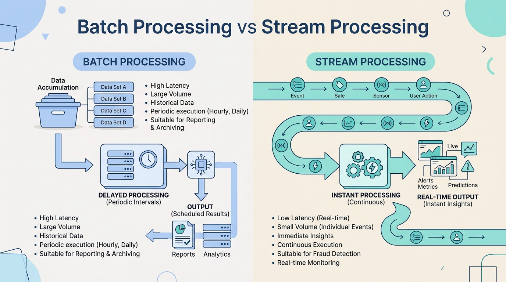
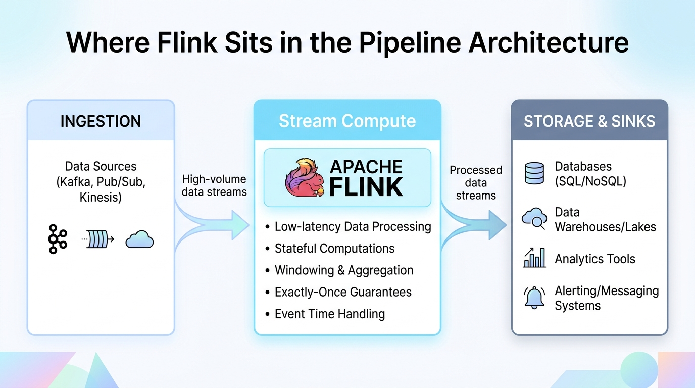
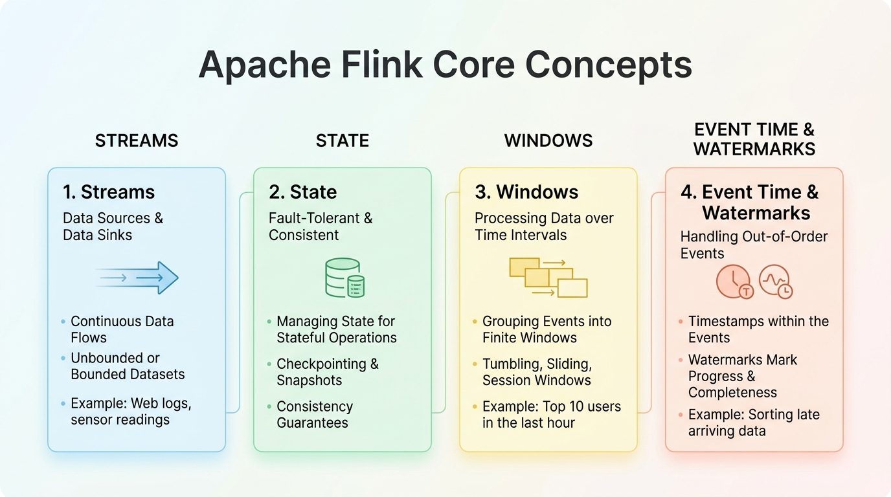
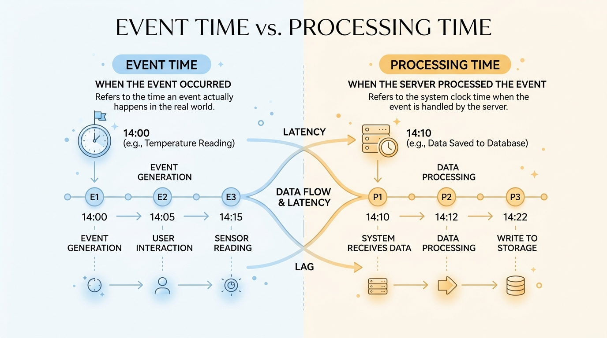
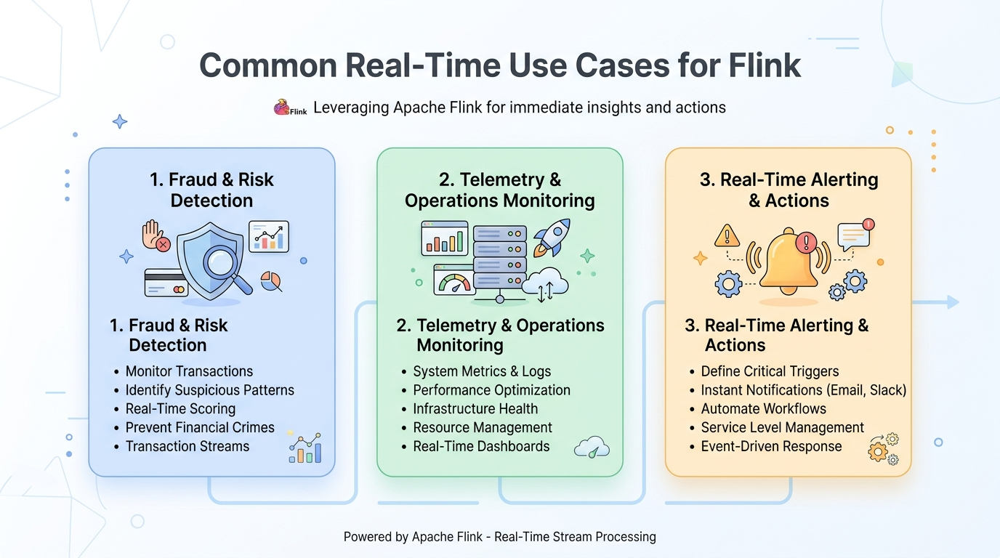
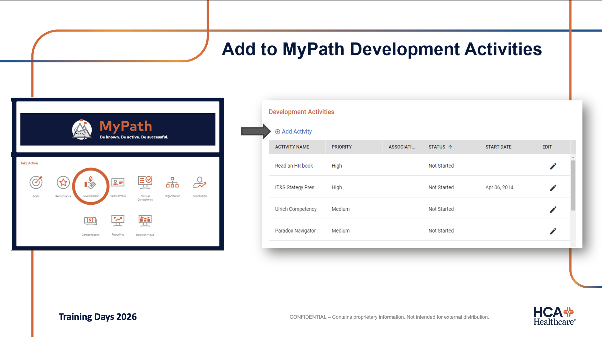

<!-- course-title: Apache Flink for Real-Time Data Processing -->

<!-- layout: full-bleed -->
# Welcome Slide

---
<!-- layout: title -->


# Apache Flink for
# Real-Time Data Processing

## Streams, state, windows, and where Flink fits in modern pipelines
---
<!-- layout: panel-right -->
# Welcome!

- ROI leads the industry in designing and delivering customized technology and management training solutions
- Meet your instructor
  - Name
  - Background
  - Contact info
- Let’s get started!


---
# Course Objectives

- Explain how Apache Flink enables low-latency stream processing in a modern data architecture
- Explain real-time stream processing and how it differs from batch
- Describe Flink’s core concepts: streams, state, windows, and event time
- Contrast DataStream and SQL/Table APIs on the same engine
- Identify common real-time use cases and judge when Flink is a fit
- Recognize how Flink fits alongside messaging and storage in a pipeline
---
<!-- layout: panel-left -->
# Agenda

- Segment 1: Streaming Fundamentals
- Segment 2: Flink Core Concepts
- Segment 3: Putting It to Work
- Questions and Answers


---
<!-- layout: panel-right -->
# Who Should Attend

- Data engineers building continuous pipelines
- Architects designing real-time platforms
- Platform engineers operating streaming infrastructure
- Analytics engineers moving from batch-only workloads


---
<!-- layout: panel-left -->
# Prerequisites

- Familiarity with software development fundamentals
- Comfort reading APIs, logs, and simple code samples
- Generative AI basics (as required by your program track)
- Helpful: prior exposure to Kafka, Pub/Sub, or data warehouses


---
<!-- layout: navigation -->
# Course Roadmap

- **Streaming Fundamentals**
- Flink Core Concepts
- Putting It to Work
---
# Why Real-Time Matters

- Hospitals and businesses increasingly need seconds, not overnight batches
- Detect ER boarding bottlenecks, ICU capacity spikes, and delayed bed turnovers while they are happening
- Power live bed-command dashboards, automated EVS (housekeeping) dispatch, and diversion alerts
- Continuous data is already flowing: batch is a delayed snapshot

> [!NOTE]
> “Real-time” is a product requirement (latency budget), not a buzzword. Define the SLA first.
---
<!-- layout: title-image -->
# Batch vs. Stream


---
<!-- layout: 2-column -->
# Latency and Throughput

### Latency
- Time from event → useful result
- Bed assignment / ICU transfer: seconds-minutes
- Monthly census report: hours is fine

### Throughput
- Events processed per second
- Streaming systems scale both
- Optimize for your bottleneck
---
# What Is Apache Flink?

- Open-source stateful stream processing engine
- Runs continuous jobs over unbounded data
- Strong model for event time, windows, and fault-tolerant state
- APIs for Java/Scala (DataStream) and SQL/Table for many teams

> [!TIP]
> Think of Flink as the compute layer for streams: similar to how Spark often serves batch/lakehouse compute.
---
<!-- layout: image-only -->
# Where Flink Sits in the Ecosystem


---
<!-- layout: 3-column -->
# Flink vs. Adjacent Tools

### Messaging
- Kafka, Pub/Sub, Pulsar
- Transport and buffer
- Not heavy compute

### Flink
- Stateful transforms
- Windows and joins
- Exactly-once sinks

### Storage
- Warehouse, lake, OLTP
- Durable history
- Serving and analytics
---
<!-- layout: 2-column -->
# Apache Flink and Confluent Cloud

### Open-Source Apache Flink
- Compute engine for stateful streams
- Historically paired with self-managed Kafka
- Teams ran separate clusters, security, and schemas
- Full control over custom Java/Scala and SQL jobs

### Confluent Cloud for Apache Flink
- Serverless, fully managed Flink alongside Kafka
- Kafka topics appear directly as Flink SQL tables
- Unified Schema Registry, governance, and RBAC
- Zero cluster sizing, checkpoint tuning, or patching

<!-- below-columns -->

> [!NOTE]
> Kafka moves the events; Flink processes them. Confluent Cloud unifies both so you can query live hospital streams without managing Flink infrastructure.
---
<!-- layout: navigation -->
# Course Roadmap

- Streaming Fundamentals
- **Flink Core Concepts**
- Putting It to Work
---
<!-- layout: title-image -->
# How Flink Works: Building Blocks


---
# Streams

- A stream is an unbounded sequence of events
- Events often carry a key (unit_id, bed_id, patient_id, facility_id)
- Operators transform streams: map, filter, keyBy, join, window
- Jobs run until cancelled - there is no natural “end of file”

```text
adt_events  →  filter(valid?)  →  keyBy(unit_id)  →  window(15m)  →  bed_demand_counts
```
---
<!-- layout: 2-column -->
# State: Memory Across Events

### Why State Exists
- Available vs. occupied beds per unit so far
- Current bed status (OCCUPIED → DIRTY → CLEANING → READY)
- Patient placement request in progress
- Predicted unit turnaround time

### Flink Responsibilities
- Local keyed state
- Checkpoint to durable store
- Restore after failure
- Scale with keyed parallelism
---
# Windowing

- Windows slice an unbounded stream into finite buckets
- Common types: tumbling, sliding, session
- Aggregations (sum, count, avg) usually happen inside a window
- Choose windows from the business question, not from habit

| Window | Idea | Example |
| :--- | :--- | :--- |
| Tumbling | Fixed, non-overlapping | Count admissions and discharges per unit every 15 minutes |
| Sliding | Fixed, overlapping | Rolling 30-minute ER-to-inpatient bed wait score every 5 minutes |
| Session | Gap-based | Track a patient’s bed-hold / transfer workflow until placement completes |
---
<!-- layout: image-only -->
# Event Time vs. Processing Time


---
# Watermarks and Late Data

- Watermarks estimate how far event time has progressed
- They let windows close even when data arrives out of order
- Late events can still be allowed within a configured lateness
- Wrong time semantics → wrong dashboards and wrong alerts

> [!IMPORTANT]
> For correctness under delay and reordering, prefer **event time** + watermarks over processing time.
---
<!-- layout: 2-column -->
# Story: The Delayed Discharge Event

### What Happened
- Nurse discharges a patient at 10:00:50 (event time) on a bedside tablet
- Tablet Wi-Fi drops in a dead zone and syncs late
- Event arrives at the Flink job at 10:01:05
- You need accurate “10:00 net bed availability” for the command center

### Processing Time vs Event Time
- Processing time: lands in the 10:01 bucket → 10:00 looks full (false diversion alert), 10:01 shows a phantom surge
- Event time + watermark: still attributed to 10:00; window closes when watermark passes 10:01
- Same bug shows up in ER boarding metrics, EVS turnaround SLAs, and staffing ratios

<!-- below-columns -->

> [!TIP]
> If your chart “looks wrong during clinical tablet Wi-Fi delays or HL7/FHIR interface bursts,” check time semantics before tuning parallelism.
---
<!-- layout: 2-column -->
# Mental Model: A Flink Job

### Sources
- Kafka topic / Pub/Sub
- Files, sockets (dev)
- CDC streams

### Operators → Sink
- Stateful keyed logic
- Windows and timers
- Write to DB, lake, alert bus
---
<!-- layout: 2-column -->
# Two APIs, Same Engine

### DataStream (Java/Scala)
- Imperative operators in code
- Full control: timers, custom state, CEP
- What the next example uses
- Best when logic is complex or bespoke

### SQL/Table API
- Declarative queries over streams and tables
- Windows, joins, aggregations in SQL
- Primary interface in Confluent Cloud for Flink
- Same runtime: state, checkpoints, event time

<!-- below-columns -->

> [!NOTE]
> Many production teams use **Flink SQL** day to day (especially in Confluent Cloud, where Kafka topics map automatically to SQL tables) and drop to DataStream only when SQL is not enough.
---
# Example: Real-Time Unit Bed Demand Job

- Read a stream of `BedRequest` events (unit, acuity, and event-time timestamp)
- `keyBy` hospital unit (`ICU`, `MED_SURG`, `TELE`) so each unit’s state is tracked independently
- Tumbling event-time windows (15 minutes) count pending bed requests per unit
- Print results: same shape as writing to Kafka, a bed-board DB, or an alerting sink

```java
public class BedDemandJob {
    public static void main(String[] args) throws Exception {
        // Local env for demos; on a cluster you'd use getExecutionEnvironment()
        StreamExecutionEnvironment env =
            StreamExecutionEnvironment.createLocalEnvironment();

        DataStream<BedRequest> requests = env
            .addSource(new BedRequestSource()) // HL7/FHIR events via Kafka in prod
            // Event time + watermarks: Flink advances "time" from the data,
            // not the wall clock - so delayed events are handled correctly
            .assignTimestampsAndWatermarks(
                WatermarkStrategy
                    .<BedRequest>forBoundedOutOfOrderness(Duration.ofSeconds(10))
                    .withTimestampAssigner((event, ts) -> event.getEventTimeMillis())
            );

        requests
            .keyBy(BedRequest::getUnitId)             // partition state by unit (e.g., ICU)
            .window(TumblingEventTimeWindows.of(Time.minutes(15)))
            .aggregate(new CountPendingRequests())    // stateful window aggregation
            .map(result -> String.format(
                "unit=%s windowEnd=%s pendingBeds=%d",
                result.getUnitId(),
                result.getWindowEnd(),
                result.getPendingCount()
            ))
            .print();                                 // replace with a real sink later

        env.execute("unit-bed-demand");
    }
}
```
---
# From `print()` to a Kafka Sink

- Swap the sink, not the window or `keyBy` logic
- Serialize the aggregate (JSON, Avro, Protobuf) for consumers
- Use a transactional/idempotent sink when you need stronger delivery guarantees
- Downstream reads a topic instead of job logs: same pipeline shape as production

```java
// Instead of:  resultStream.print();
resultStream.sinkTo(
    KafkaSink.<String>builder()
        .setBootstrapServers("kafka:9092")
        .setRecordSerializer(
            KafkaRecordSerializationSchema.builder()
                .setTopic("unit-bed-demand-alerts")
                .setValueSerializationSchema(new SimpleStringSchema())
                .build()
        )
        .setDeliveryGuarantee(DeliveryGuarantee.AT_LEAST_ONCE)
        .build()
);
```

> [!TIP]
> Source → stateful operators → sink is the whole job. Changing Kafka topic names or sink guarantees should not require rewriting your window math.
---
<!-- layout: 2-column -->
# Same Job in Confluent Cloud (Flink SQL)

### How It Works in Confluent Cloud
- Kafka topics (`bed_requests`, `unit_bed_demand_alerts`) auto-register as SQL tables
- Schema Registry supplies column types and event-time watermarks
- `INSERT INTO` launches a continuous, stateful Flink job
- No Java boilerplate, serializer code, or cluster setup

### Flink SQL Query
```sql
INSERT INTO unit_bed_demand_alerts
SELECT
  unit_id,
  window_end,
  COUNT(*) AS pending_beds
FROM TABLE(
  TUMBLE(
    TABLE bed_requests,
    DESCRIPTOR(event_time),
    INTERVAL '15' MINUTES
  )
)
GROUP BY
  unit_id,
  window_start,
  window_end;
```

<!-- below-columns -->

> [!NOTE]
> Under the hood, Flink compiles this SQL into the exact same stateful `keyBy` + tumbling event-time window execution graph as the Java DataStream job.
---
<!-- layout: navigation -->
# Course Roadmap

- Streaming Fundamentals
- Flink Core Concepts
- **Putting It to Work**
---
<!-- layout: image-only -->
# Common Real-Time Use Cases


---
<!-- layout: 3-column -->
# Pattern Snapshots

### Bed Scheduling
- Match admissions with clean beds
- Enrich with isolation and acuity rules
- Route holds to bed command

### Patient Telemetry
- Roll up vitals and bed-sensor metrics
- Detect deterioration early
- Feed nurse station views

### Capacity Alerting
- Detect ER boarding thresholds
- Deduplicate delayed turn alerts
- Page charge nurses and EVS
---
# Integration: Messaging In, Sinks Out

- Ingress: Kafka (Confluent Cloud), Google Pub/Sub, Kinesis, Pulsar
- Egress: warehouses, lakes, OLTP, search, notification topics
- Managed platforms like Confluent Cloud handle checkpoints, scaling, and Schema Registry integration automatically
- Design for replay: keep source offsets and idempotent sinks

> [!WARNING]
> A Flink job is only as reliable as its checkpoint storage, restart strategy, and sink semantics.
---
<!-- layout: 2-column -->
# Architecture Checklist

### Fit for Flink
- Continuous events
- Stateful decisions
- Sub-minute latency
- Complex event logic

### Consider Alternatives
- Pure batch/micro-batch OK
- Simple filter at the broker
- Request/response APIs only
- Tiny volume, rare jobs
---
# Putting It Together

```text
Producers → Kafka/Pub/Sub → Flink (stateful jobs)
                              ├─→ Alerting / Actions
                              ├─→ Serving DB / Cache
                              └─→ Lakehouse / Warehouse
```

- Flink owns compute + state for the stream path
- Messaging owns durable transport and fan-out
- Storage owns history, BI, and downstream ML features
---
<!-- layout: 3-column -->
# Would You Use Flink?

### Yes
**Live hospital bed scheduling**
- Every ADT and housekeeping event updates unit availability live
- Sub-minute matching of ER boarders to clean, appropriate beds
- Stateful per-unit and per-bed lifecycle logic is the product

### No
**Monthly inpatient utilization workbook**
- Operations needs last month’s occupancy totals by the 5th business day
- Batch/warehouse job is enough
- No continuous consumer waiting on the stream

### Maybe
**ADT stream → warehouse + diversion alerts**
- Flink (or SQL) for live ER boarding and bed-turn anomaly windows
- Micro-batch OK for historical length-of-stay analytics
- Split: speed path vs history path

<!-- below-columns -->

> [!IMPORTANT]
> Ask: Do we need **continuous stateful compute** on the event path or just fresher batch?
---
# What You Learned

- Explained real-time stream processing and how it differs from batch
- Described Flink’s core concepts: streams, state, windows, and event time
- Contrasted DataStream and SQL/Table APIs on the same engine
- Identified common real-time use cases suited to Flink
- Recognized how Flink fits alongside messaging and storage in a pipeline
- Judged fit for Flink with yes/no/maybe scenarios
---
# Quiz 1 of 3

**A patient discharge is recorded at 10:00:50 on a bedside tablet, but due to Wi-Fi delay the event arrives at the Flink job at 10:01:05. For accurate “10:00 bed availability,” which approach attributes it to the 10:00 bucket?**

- A. Processing time only (wall-clock arrival)
- B. Dropping any event that arrives after the minute ends
- C. Ignoring timestamps and counting in arrival order
- D. Event time with watermarks (and configured lateness)
---
# Quiz 1: Answer

**A patient discharge is recorded at 10:00:50 on a bedside tablet, but due to Wi-Fi delay the event arrives at the Flink job at 10:01:05. For accurate “10:00 bed availability,” which approach attributes it to the 10:00 bucket?**

**Correct: D.** Event time with watermarks (and configured lateness)

- Event time uses the time in the event, not when the job saw it
- Watermarks let windows close despite out-of-order arrival
- Processing time would put the discharge in the 10:01 bucket
- Wrong time semantics break bed availability dashboards, EVS turnaround SLAs, and diversion alerts
---
# Quiz 2 of 3

**Which workload is the clearest fit for Apache Flink?**

- A. A nightly hospital census workbook leadership reviews at 7 a.m.
- B. Matching incoming ER admissions to available, clean inpatient beds in real time as ADT and housekeeping events arrive
- C. A one-off SQL pull for a quarterly board slide
- D. A simple broker-side filter with no state or windows
---
# Quiz 2: Answer

**Which workload is the clearest fit for Apache Flink?**

**Correct: B.** Matching incoming ER admissions to available, clean inpatient beds in real time as ADT and housekeeping events arrive

- Flink shines on continuous, stateful, low-latency event paths
- Nightly batch and one-off analytics usually belong in the warehouse
- Messaging transports events; Flink owns compute, state, and windows
- Ask: do we need continuous stateful compute - or just fresher batch?
---
<!-- layout: 2-column -->
# Quiz 3 of 3: Discussion

### Prompt
Describe a real-time use case on your team (bed scheduling, patient telemetry, capacity alerting, or operational streams).

### Discuss
- Where do messaging, Flink, and storage each sit in the pipeline?
- Would you use tumbling, sliding, or session windows - and why?
- When would DataStream be worth it instead of Flink SQL?
---
<!-- layout: 2-column -->
# Quiz 3: Discussion Points

**Describe a real-time use case on your team (bed scheduling, patient telemetry, capacity alerting, or operational streams).**

### Strong Answers Mention
- Messaging = transport; Flink = stateful compute; storage = history/BI
- Window choice follows the business question
- Event time + watermarks when delay/reorder matters
- SQL for analytics-style jobs; DataStream for custom state/timers/CEP

### Watch For
- Treating Kafka as the compute engine
- Processing-time windows for correctness-critical metrics
- Using Flink for pure overnight batch with no continuous consumer
---
<!-- layout: title-image -->
# Questions and Answers


---
<!-- layout: full-bleed -->
# Survey

---
<!-- layout: full-bleed -->
# My Path

---
<!-- layout: full-bleed -->
# Thank You

