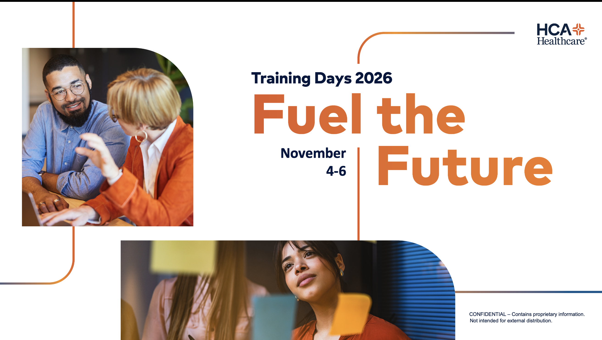
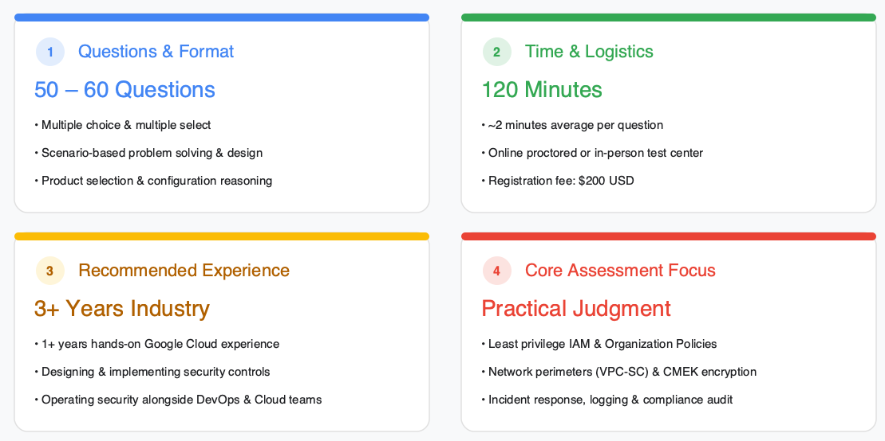
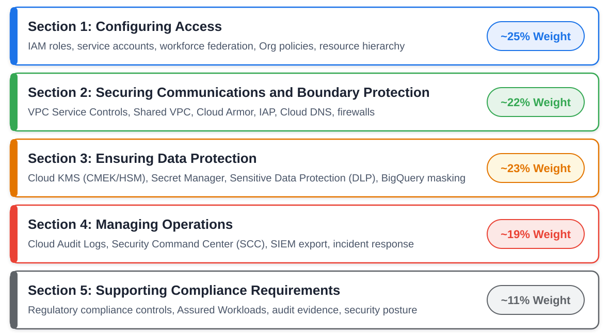
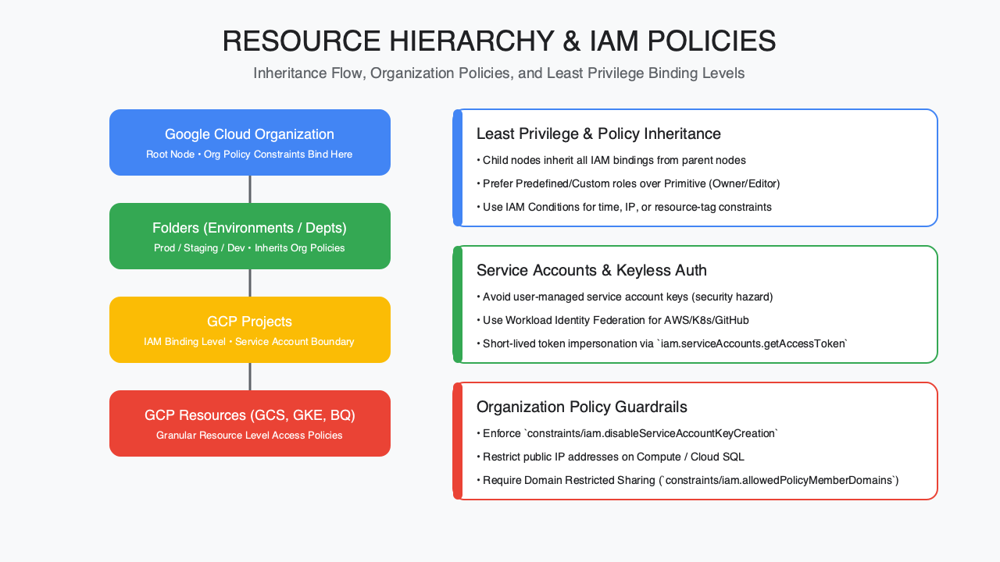
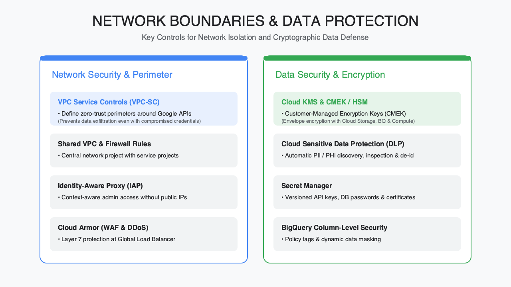
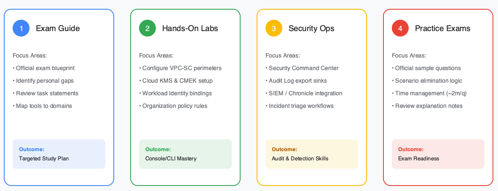

<!-- course-title: Professional Cloud Security Engineer Certification Overview -->

<!-- layout: full-bleed -->
# Welcome Slide

---
<!-- layout: title -->

# Professional Cloud Security Engineer
# Certification Overview

## Exam scope, domain tour, and a practical preparation path
---
<!-- layout: panel-right -->
# Welcome!

- ROI leads the industry in designing and delivering customized technology and management training solutions
- Meet your instructor
  - Name
  - Background
  - Contact info
- Let’s get started!

---
# Course Objectives

- Orient to the Google Professional Cloud Security Engineer (PCSE) exam: scope, domains, and how to prepare
- Describe the certification’s scope, format, and exam expectations
- Summarize the core exam domains and what each tests
- Identify the highest-yield preparation resources and study path
- Recognize where hands-on experience is required to pass
---
<!-- layout: panel-left -->
# Agenda

- Segment 1: Exam Overview
- Segment 2: Core Domains Tour
- Segment 3: Operations, Compliance, and Prep
- Questions and Answers

---
<!-- layout: panel-right -->
# Who Should Attend

- Cloud security engineers preparing for PCSE
- Security architects validating Google Cloud depth
- Platform engineers expanding into security ownership
- Candidates with Google Cloud project experience seeking a study map

---
<!-- layout: panel-left -->
# Prerequisites

- Prior Google Cloud experience (projects, IAM, networking basics)
- Foundational security knowledge (identity, encryption, logging)
- Helpful: Associate Cloud Engineer or equivalent hands-on background
- Helpful: exposure to Security Command Center and VPC design

---
<!-- layout: navigation -->
# Course Roadmap

- **Exam Overview**
- Core Domains Tour
- Operations, Compliance, and Prep
---
# What the Certification Validates

- **Access and Identity Management:** Configure IAM roles, policies, and service accounts
- **Network and Boundary Protection:** Implement VPC security, firewalls, and Cloud Armor
- **Data Protection and Encryption:** Manage KMS keys, DLP, and encryption standards
- **Security Operations and Monitoring:** Utilize Security Command Center, logging, and threat detection
- **Compliance and Governance:** Enforce security controls and audit compliance frameworks

> [!NOTE]
> Always verify details against the current official Google Cloud exam guide: blueprints refresh over time.
---
<!-- layout: title-image -->
# Exam at a Glance

---
<!-- layout: title-image -->
# Domain Map (Approximate Weights)

---
<!-- layout: navigation -->
# Course Roadmap

- Exam Overview
- **Core Domains Tour**
- Operations, Compliance, and Prep
---
<!-- layout: title-image -->
# Section 1: Configuring Access (~25%)

---
# Configuring Access: Key Exam Topics

- Resource hierarchy: org → folders → projects → resources
- Least privilege with predefined/custom roles and conditions
- Service accounts, impersonation, and keyless patterns
- Federation/workforce identity concepts at a design level
- Organization Policy constraints that enforce guardrails

| Theme | Example decision |
| :--- | :--- |
| Hierarchy | Where to bind a role for inheritance |
| SA security | Avoid user-managed keys when possible |
| Org policy | Restrict public IPs / SA key creation |
---
<!-- layout: title-image -->
# Sections 2 and 3: Network and Data Protection

---
<!-- layout: 2-column -->
# Section 2: Securing Communications and Boundary Protection (~22%)

### Expect Coverage Of
- VPC firewalls/NGFW ideas
- Segmentation (Shared VPC, peering)
- IAP for admin access patterns
- Cloud Armor/edge protections
- Private Google Access, PSC, VPN/Interconnect
- VPC Service Controls perimeters

### Mindset
- Identity + network together
- Default-deny where sensible
- Private paths over public exposure
---
<!-- layout: 2-column -->
# Section 3: Ensuring Data Protection (~23%)

### Expect Coverage Of
- Encryption at rest / in transit
- Cloud KMS, CMEK, HSM patterns
- Envelope encryption concepts
- Sensitive Data Protection / DLP
- Dataset access patterns (e.g., BigQuery)
- Securing AI/ML data paths (newer emphasis)

### Mindset
- Who holds keys?
- Where does data leave?
- How is sensitive data discovered?
---
# Network and Data Study Priorities

- **Master VPC Service Controls:** Know how perimeters, access levels, and ingress/egress rules prevent data exfiltration
- **Layer network boundaries:** Practice choosing between Shared VPC, VPC peering, IAP, Cloud Armor, and Private Service Connect
- **Know encryption key ownership:** Distinguish default Google-managed keys, CMEK, CSEK, Cloud EKM, and Cloud HSM trade-offs
- **Automate sensitive data discovery:** Pair Sensitive Data Protection (DLP) inspection and de-identification with BigQuery policy tags

> [!TIP]
> Sections 1, 2, and 3 represent roughly 70% of the exam: deepen IAM, VPC-SC, and KMS until trade-offs feel automatic.
---
<!-- layout: navigation -->
# Course Roadmap

- Exam Overview
- Core Domains Tour
- **Operations, Compliance, and Prep**
---
# Section 4: Managing Operations (~19%)

- Detect and respond using Google Cloud security operations tooling
- Security Command Center findings, priorities, and remediation workflows
- Logging, monitoring, and detection design (what to log; where to sink)
- Incident-oriented scenarios: investigate → contain → improve controls

| Ops theme | Why it’s tested |
| :--- | :--- |
| SCC | Centralize posture and findings |
| Logging | Evidence + detection inputs |
| Automation | Scale response consistently |
---
<!-- layout: 2-column -->
# Section 5: Supporting Compliance Requirements (~11%)

### What It Covers
- Mapping controls to requirements
- Shared responsibility clarity
- Assured/compliance-oriented offerings at a conceptual level
- Evidence from configs, logs, and policies

### How to Study
- Know *which Google Cloud controls* support common goals
- Don’t memorize every regulation clause
- Tie answers back to hierarchy, network, data, ops
---
<!-- layout: title-image -->
# High-Yield Study Path

---
# Highest-Yield Preparation Resources

1. **Official exam guide:** Source of truth for domains and in-scope topics
2. **Google Skills labs:** Hands-on experience is essential
3. **Architecture Center security patterns:** Identify best practices
4. **Practice exams and sample questions:** Timing and scenario stamina

> [!WARNING]
> Outdated third-party dumps are not always accurate.
---
# Where Hands-On Experience Is Required

- **IAM and Workload Identity:** Configuring custom roles and resource hierarchies
- **Network Defenses:** Building VPC Service Controls and Cloud Armor policies
- **Encryption (KMS):** Implementing Customer-Managed Encryption Keys (CMEK)
- **Security Operations:** Setting up Security Command Center (SCC) and audit log exports
- **Data Privacy:** Using Cloud DLP to inspect and mask sensitive data
- **GKE Security:** Hardening clusters with RBAC and network policies
---
# Sample 4–6 Week Prep Outline

| Week | Focus |
| :--- | :--- |
| 1 | Exam guide + IAM/hierarchy labs |
| 2 | Network boundary + VPC-SC scenarios |
| 3 | KMS/encryption + data protection |
| 4 | SCC, logging, ops playbooks |
| 5 | Compliance mapping + practice exam |
| 6 | Gap remediation + light review |
---
<!-- layout: 2-column -->
# Exam-Taking Tips

### Reading the Scenario
- Identify the core security requirement first (least privilege, exfiltration prevention, key control, or compliance)
- Eliminate answers that rely on manual toil, primitive roles (`Owner`/`Editor`), or user-managed service account keys
- Watch for qualifiers like *least operational overhead*, *Google-recommended*, or *strict regulatory control*

### Pacing and Strategy
- Budget roughly 2 minutes per question across the 120-minute window
- Flag long multi-service architecture questions, lock in your best answer, and revisit at the end
- Choose native managed Google Cloud controls (VPC-SC, IAP, CMEK, SCC) over custom scripts when both solve the risk
---
# What You Learned

- Described PCSE scope, format, and exam expectations
- Summarized the five core domains and what each tests
- Identified high-yield resources and a practical study path
- Recognized where hands-on Google Cloud experience is required to pass
---
# Quiz 1 of 3

**If study time is short, which PCSE focus set is the highest-yield priority?**

A. Niche product edges and third-party exam dumps only

B. Compliance regulation clause memorization before any labs

C. Access (IAM) + Network + Data (including VPC-SC and KMS)

D. Skipping hands-on labs if you’ve read the exam guide twice
---
# Quiz 1: Answer

**If study time is short, which PCSE focus set is the highest-yield priority?**

**Correct: C.** Access (IAM) + Network + Data (including VPC-SC and KMS)

- Access, Network, and Data make up the majority of the exam weight
- VPC-SC and KMS trade-offs should feel automatic under time pressure
- Official guide + labs beat outdated third-party dumps
- Reading alone rarely replaces console/`gcloud` muscle memory
---
# Quiz 2 of 3

**A scenario asks how to stop an authorized user from copying BigQuery data to an unapproved project. Which control is the exam’s best “choose the product” answer?**

A. VPC Service Controls perimeters around the sensitive resources

B. Granting the user Owner so they can self-manage exports

C. Disabling Cloud Logging to reduce noise

D. Relying only on a broader predefined Editor role
---
# Quiz 2: Answer

**A scenario asks how to stop an authorized user from copying BigQuery data to an unapproved project. Which control is the exam’s best “choose the product” answer?**

**Correct: A.** VPC Service Controls perimeters around the sensitive resources

- VPC-SC limits *where* data can go even with valid credentials
- IAM answers *who*; it does not stop authorized exfiltration alone
- Owner/Editor widen blast radius: opposite of least privilege
- Logging helps investigate; it does not enforce the perimeter
---
<!-- layout: 2-column -->
# Quiz 3 of 3: Discussion

### Prompt
Draft a 4–6 week PCSE prep plan for someone with Associate-level Google Cloud experience but little VPC-SC or CMEK practice.

### Discuss
- Which weeks are labs vs. reading vs. practice exams?
- Where must hands-on experience replace flashcards?
- How will you verify readiness against the official exam guide?
---
<!-- layout: 2-column -->
# Quiz 3: Discussion Points

**Draft a 4–6 week PCSE prep plan for someone with Associate-level Google Cloud experience but little VPC-SC or CMEK practice.**

### Strong Answers Mention
- Official exam guide as source of truth for domains
- Early weeks: IAM hierarchy, network/VPC-SC, KMS/CMEK labs
- Later weeks: SCC/ops, compliance mapping, practice exams
- Study loop: read task → build in sandbox → explain trade-offs aloud

### Watch For
- Memorizing trivia instead of “choose the control” scenarios
- Skipping labs for VPC-SC, CMEK, or SCC
- Trusting outdated dumps over recent official materials
---
<!-- layout: title-image -->
# Questions and Answers

---
<!-- layout: full-bleed -->
# Survey

---
<!-- layout: full-bleed -->
# My Path

---
<!-- layout: full-bleed -->
# Thank You

