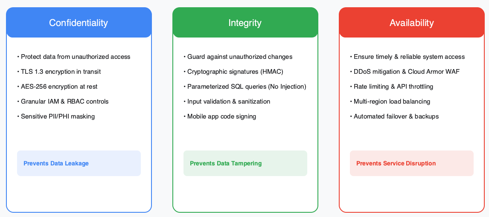
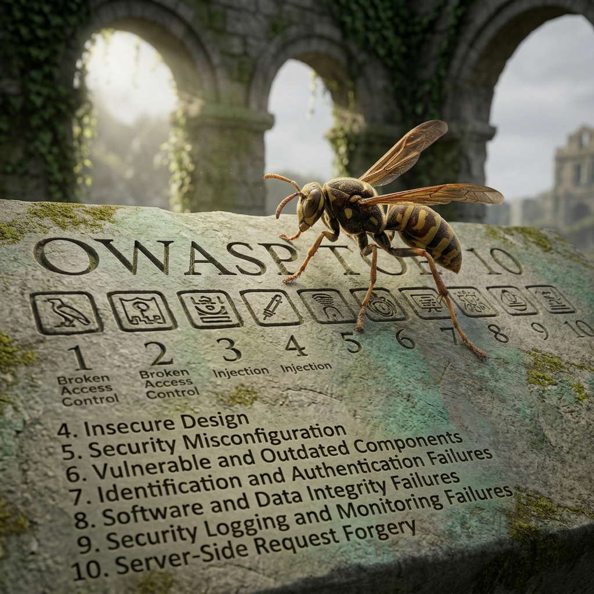
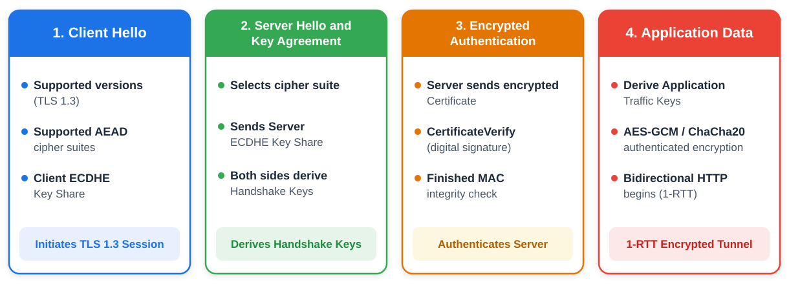
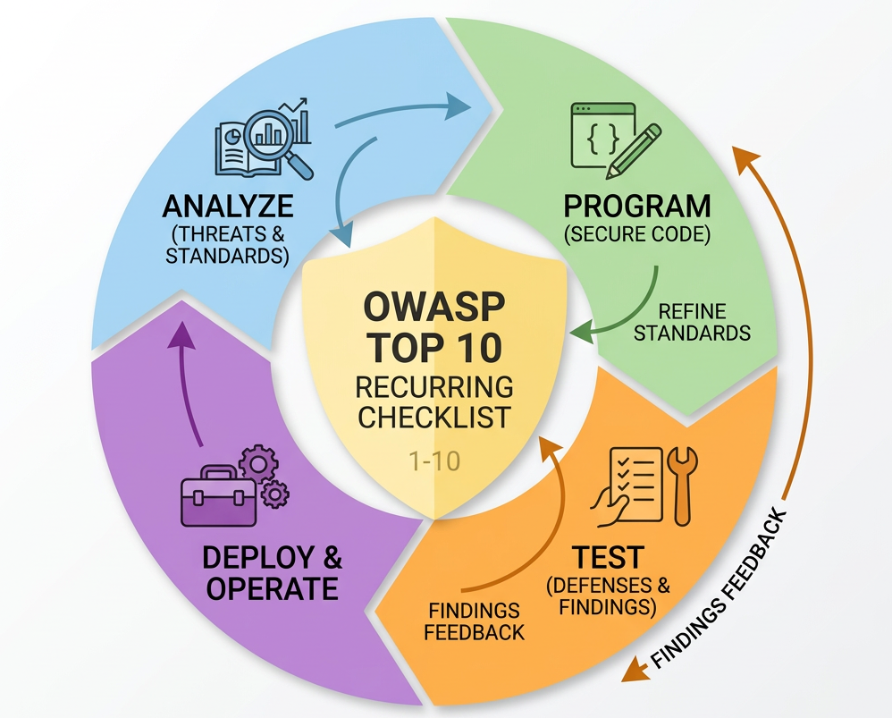
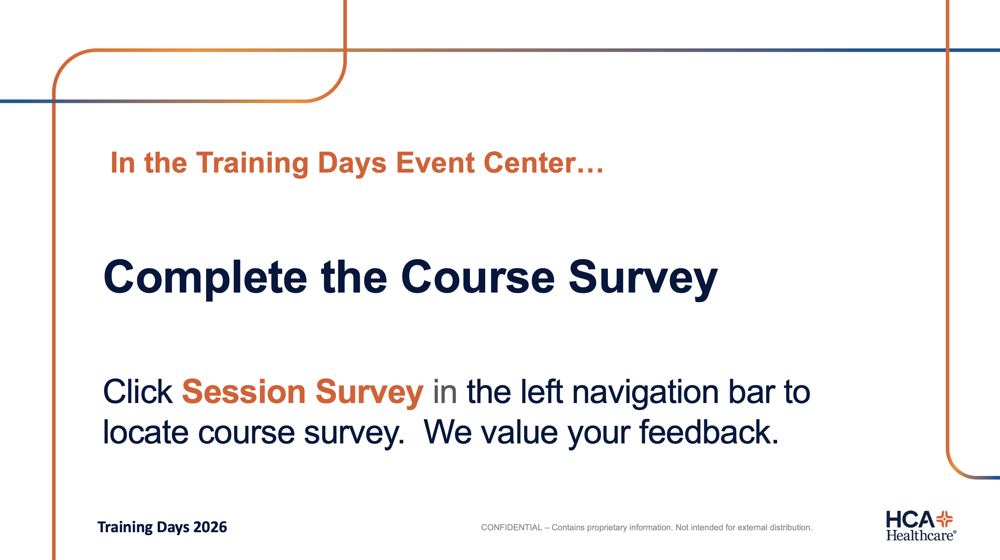
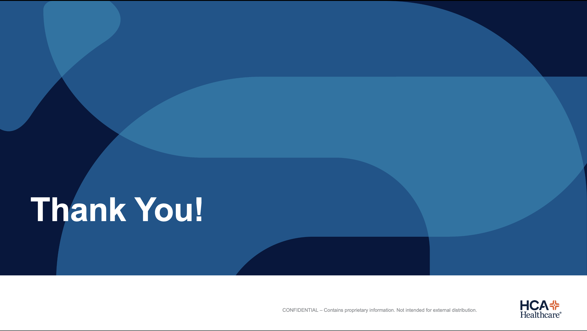

<!-- course-title: Web and Mobile Application Security -->

<!-- layout: full-bleed -->
# Welcome Slide

---
<!-- layout: title -->

# Web and Mobile
# Application Security

## Secure design that keeps apps safe
---
<!-- layout: panel-right -->
# Welcome!

- ROI leads the industry in designing and delivering customized technology and management training solutions
- Meet your instructor
  - Name
  - Background
  - Contact info
- Let’s get started!

---
# Course Objectives

- Secure web and mobile applications against common vulnerabilities using sound design, encryption, and testing
- Describe the fundamentals of securing web and mobile applications
- Identify the most common web and mobile vulnerabilities (OWASP Top 10)
- Explain how encryption protects confidentiality and integrity
- Recognize automated tools for testing application vulnerabilities
---
<!-- layout: panel-left -->
# Agenda

- Segment 1: Security Fundamentals
- Segment 2: The OWASP Top 10, web and mobile
- Segment 3: Defenses and Testing
- Questions and Answers

---
<!-- layout: panel-right -->
# Who Should Attend

- Developers building web or mobile applications
- Security staff and technical leads
- Some development familiarity is helpful, not required

---
<!-- layout: panel-left -->
# Prerequisites

- No prior security experience required
- Familiarity with web or mobile development is helpful, but not required

---
<!-- layout: navigation -->
# Course Roadmap

- **Security Fundamentals**
- The OWASP Top 10
- Defenses and Testing
---
# Groundwork: Why Application Security Matters

- Most breaches trace back to application-layer weaknesses, not just network perimeter failures
- Security is cheapest to fix at design time and most expensive after release
- Every application has two attack surfaces: the code, and the people who use it
- This segment sets the shared vocabulary the rest of the course builds on
---
<!-- layout: title-image -->
# The CIA Triad

---
<!-- layout: 2-column -->
# Hardening the System vs. Protecting the User

### Technical Controls (The Code)
- **Treat all input as untrusted:** Validate, sanitize, and encode data at every layer
- **Default to denial:** Ensure systems fail securely (lock down, don’t open up) on errors
- **Enforce least privilege:** Grant only the permissions strictly required to function

### Human-Centric Controls (The Interface)
- **Transparent consent:** Use plain-language security prompts instead of deceptive UI
- **Safe by default:** Ship features with the most secure configuration pre-selected
- **Resilient design:** Build guardrails that forgive human error instead of blaming the user
---
# Where Security Fits in the Lifecycle

| Stage | Security activity |
| :--- | :--- |
| Design | Threat modeling |
| Build | Secure coding standards, code review |
| Test | Automated (SAST/DAST) scanning |
| Release | Dependency and configuration checks |
| Operate | Monitoring and patching |
---
# Introducing OWASP

- OWASP (Open Worldwide Application Security Project) is a nonprofit community publishing free, vendor-neutral security guidance
- Best known for the OWASP Top 10: a ranked list of the most critical risks, refreshed periodically
- Separate Top 10 lists exist for web applications and for mobile applications
- Treat it as a floor, not a ceiling: passing the Top 10 doesn’t mean an app is fully secure

> [!NOTE]
> The OWASP Top 10 is a snapshot of common risk categories, not an exhaustive checklist.
---
<!-- layout: navigation -->
# Course Roadmap

- Security Fundamentals
- **The OWASP Top 10**
- Defenses and Testing
---
# Know the Threats

- The OWASP Top 10 groups real-world vulnerabilities into risk categories, not a trivia list
- Categories represent a pattern of exploits, not a single bug
- We’ll walk the web list first, then the mobile-specific list
- Watch for the categories that show up in both

---
<!-- layout: 2-column -->
# OWASP Top 10: Web vs. Mobile

### Web (2025)
- **A01:2025** - Broken Access Control
- **A02:2025** - Security Misconfiguration
- **A03:2025** - Software Supply Chain Failures
- **A04:2025** - Cryptographic Failures
- **A05:2025** - Injection
- **A06:2025** - Insecure Design
- **A07:2025** - Authentication Failures
- **A08:2025** - Software or Data Integrity Failures
- **A09:2025** - Security Logging and Alerting Failures
- **A10:2025** - Mishandling of Exceptional Conditions

### Mobile
- **M1:** Improper Credential Usage
- **M2:** Inadequate Supply Chain Security
- **M3:** Insecure Authentication/Authorization
- **M4:** Insufficient Input/Output Validation
- **M5:** Insecure Communication
- **M6:** Inadequate Privacy Controls
- **M7:** Insufficient Binary Protections
- **M8:** Security Misconfiguration
- **M9:** Insecure Data Storage
- **M10:** Insufficient Cryptography
---
# Mobile Apps: Same Principles, Different Surface

- Mobile adds a local device, app store, and platform layer to the same core risks
- Data at rest on the device is now part of your attack surface
- Users can’t patch instantly; app-store review cycles slow response
- The OWASP Mobile Top 10 reflects these differences

---
<!-- layout: 2-column -->
# Web and Mobile: Shared Lessons

### What Repeats
- Never trust client-side input or checks
- Least privilege for every account and API call
- Patch and update on a schedule, not “eventually”

### What Differs
- Mobile adds on-device data and app-store review cycles
- Web adds session and cookie-specific risks
- Both need server-side enforcement as the real control

<!-- below-columns -->

> [!NOTE]
> The exact ranking and names shift with each OWASP Top 10 refresh: know the patterns, not just the current list.
---
<!-- layout: navigation -->
# Course Roadmap

- Security Fundamentals
- The OWASP Top 10
- **Defenses and Testing**
---
# Protecting Apps: From Detection to Defense

- Segments 1 and 2 covered what breaks; this segment covers what to build and test
- Two complementary layers: protect data and traffic, then verify with testing
- No single control is sufficient: defense in depth applies to applications too
---
# Encryption: Confidentiality and Integrity in Practice

- Encryption at rest: protects stored data if a disk, backup, or device is exposed
- Encryption in transit: TLS protects data moving between client and server
- Hashing (not encryption) verifies integrity: passwords should be hashed, never encrypted
- Strong, current algorithms and libraries matter more than a custom implementation
---
<!-- layout: title-image -->
# TLS Handshake at a Glance

---
# Securing the Server: TLS Configuration

- Terminate TLS with current protocol versions; disable deprecated ones (TLS 1.0/1.1/1.2)
- Redirect all HTTP traffic to HTTPS; use HSTS to enforce it
- Rotate and protect private keys: treat them as secrets
---
<!-- layout: 2-column -->
# Firewalls and Intrusion Detection

### Firewalls
- Filter traffic by port, protocol, and address
- Web Application Firewalls (WAF) inspect HTTP-layer traffic for known attack patterns

### Intrusion Detection/Prevention
- IDS monitors and alerts on suspicious activity
- IPS actively blocks traffic matching known attack signatures
---
# Defense in Depth for Applications

| Layer | Example control |
| :--- | :--- |
| Network | Firewall, IDS / IPS |
| Transit | TLS, HSTS |
| Application | Input validation, secure frameworks |
| Data | Encryption at rest, hashing |
---
# Why Test, Not Just Design

- Secure design reduces risk; testing confirms it holds up
- Automated tools catch known patterns fast and repeatably
- Manual testing (penetration testing) finds logic flaws automation misses
- Testing belongs in the pipeline, not just before a big release

---
<!-- layout: 2-column -->
# Security Testing Tool Categories

### Automated Scanning
- SAST (Static): scans source code without running it
- DAST (Dynamic): attacks a running app like a real attacker; e.g., OWASP ZAP

### Broader Coverage
- SCA: flags vulnerable third-party dependencies
- Mobile-specific scanners check app binaries and platform configuration
---
# Closing the Loop

- Fundamentals (Segment 1) + known threats (Segment 2) + defenses (Segment 3) form one continuous practice
- Testing findings should feed back into secure coding standards, not just a one-time fix list
- Treat the OWASP Top 10 as a recurring checklist across the whole lifecycle, not a one-time gate

---
# What You Learned

- Described the fundamentals of securing web and mobile applications
- Identified the most common web and mobile vulnerabilities (OWASP Top 10)
- Explained how encryption protects confidentiality and integrity
- Recognized automated tools for testing application vulnerabilities
---
# Quiz 1 of 3

**When hardening an application, which practice best combines technical controls in the code with human-centric controls in the interface?**

A. Relying on client-side UI validation alone and enabling risky features by default for convenience

B. Failing open on server errors so users are never interrupted, and hiding security settings in complex menus

C. Validating and sanitizing all input on the server, failing securely (default to denial), and shipping safe-by-default configurations with plain-language consent

D. Storing user passwords with reversible encryption and blaming users when they click deceptive prompts
---
# Quiz 1: Answer

**When hardening an application, which practice best combines technical controls in the code with human-centric controls in the interface?**

**Correct: C.** Validating and sanitizing all input on the server, failing securely (default to denial), and shipping safe-by-default configurations with plain-language consent

- Technical controls treat all input as untrusted, enforce least privilege, and default to denial (fail closed) on errors
- Human-centric controls use transparent consent, safe defaults, and resilient guardrails that forgive human error
- Client-side-only checks (A) are easily bypassed; server-side enforcement is mandatory
- Passwords must be hashed, never stored with reversible encryption (D)
---
# Quiz 2 of 3

**Your pipeline needs both “scan source without running it” and “attack a running app.” Which pairing matches SAST and DAST?**

A. SAST = dependency CVE feed only; DAST = certificate pinning

B. SAST = static source analysis; DAST = dynamic testing of a live app (e.g. OWASP ZAP)

C. SAST = firewall rules; DAST = OS patching

D. SAST and DAST are interchangeable names for the same scanner
---
# Quiz 2: Answer

**Your pipeline needs both “scan source without running it” and “attack a running app.” Which pairing matches SAST and DAST?**

**Correct: B.** SAST = static source analysis; DAST = dynamic testing of a live app (e.g., OWASP ZAP)

- SAST analyzes source without executing the app
- DAST probes a running application like an attacker
- SCA covers third-party dependencies; it is related but distinct
- Use both in the lifecycle: design reduces risk; testing confirms it
---
<!-- layout: 2-column -->
# Quiz 3 of 3: Discussion

### Prompt
Compare securing a browser web app vs. a native mobile app that stores a session token on-device.

### Discuss
- Which OWASP-style risks overlap, and which are mobile-specific?
- Where must authorization be enforced: client, server, or both?
- How would encryption at rest, TLS, and testing tools differ by platform?
---
<!-- layout: 2-column -->
# Quiz 3: Discussion Points

**Compare securing a browser web app vs. a native mobile app that stores a session token on-device.**

### Strong Answers Mention
- Never trust client-side checks; server enforces every sensitive action
- Mobile adds insecure local storage and app-store patch lag
- Web adds session/cookie risks; both need least privilege and patching
- SAST/DAST/SCA (and mobile binary scanners) feed coding standards

### Watch For
- Hardcoded API keys in the mobile binary
- “HTTPS means the app is secure”
- Treating OWASP Top 10 as a one-time gate, not a recurring checklist
---
<!-- layout: title-image -->
# Questions and Answers

---
<!-- layout: full-bleed -->
# Survey

---
<!-- layout: full-bleed -->
# My Path

---
<!-- layout: full-bleed -->
# Thank You

